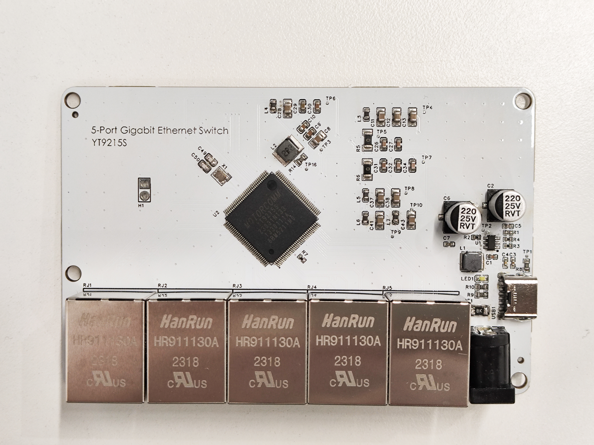

# YT9215S 5-port gigabit Ethernet switch (基于裕太微YT9215S的五口千兆交换机)

A mirror of the open hardware project
**[基于裕太微YT9215S的五口千兆交换机](https://oshwhub.com/pankanwen/wu-kou-qian-zhao-jiao-huan-ji-_yt9215s_v2_0)**
("5-port gigabit Ethernet switch based on the Motorcomm YT9215S"), designed by
**[pankanwen](https://oshwhub.com/pankanwen)** and published on OSHWHub (立创开源硬件平台).

## Author and credit

All design work, photos and the original description in this repository are by
**pankanwen** ([oshwhub.com/pankanwen](https://oshwhub.com/pankanwen)). This repository
is only a mirror; the original project page is the canonical source:

* Project page: <https://oshwhub.com/pankanwen/wu-kou-qian-zhao-jiao-huan-ji-_yt9215s_v2_0>
* Open in EasyEDA Pro (嘉立创EDA专业版): <https://pro.lceda.cn/editor#id=81622a3a90204e8685b9f33b56559349>
* Created 2023-09-04, last updated 2023-10-26 (first published 2023-09-08)

Please credit pankanwen and link to the original project page in anything derived from it.

## License

The original project is published under
**[Creative Commons Attribution-NonCommercial-ShareAlike 3.0](https://creativecommons.org/licenses/by-nc-sa/3.0/)**
(CC BY-NC-SA 3.0), as declared on the OSHWHub project page. The full legal text is in
[LICENSE](LICENSE). In short: you may share and adapt it with attribution, **not for
commercial purposes**, and derivatives must use the same license.

The author also states (translated): *"The schematic and software of this project are for
learning and exchange only and must not be used for any commercial purpose."*

The mirror maintainer's additions (README, English translation, file reorganisation,
CSV conversions) are offered under the same license.

## What is it?

An unmanaged ("dumb") 5-port gigabit Ethernet switch built around the
[Motorcomm (裕太微电子)](https://www.motor-comm.com/) **YT9215S** switch chip.

* 5 × 10/100/1000BASE-T RJ45 ports (HanRun HR911130A jacks with integrated magnetics)
* Powered from USB Type-C (5 V), with a footprint for a 12 V DC barrel jack
* MT2492 buck converter for the core supply; option to use the YT9215S's internal 1.1 V DC-DC
* 25 MHz crystal, strap resistors for configuration, no EEPROM/flash required ("无需配置固件")
* 2-layer PCB, 100 mm × 65 mm (3937 × 2559 mil)
* Measured about 1.6 W with three ports active; a heatsink on the chip is recommended
  (over 75 °C without one)

The YT9215S is described as pin-to-pin compatible with the Realtek RTL8367S, and the
schematic symbol and BOM entry for U2 use the **RTL8367S-CG** part. The author reports that
an RTL8367S did *not* boot on this board, while the YT9215S works. **Fit a YT9215S for U2.**

See the full description: [English translation](docs/description.en.md) ·
[原文 (Chinese original)](docs/description.zh-CN.md).

## Repository contents

| Path | Contents |
| --- | --- |
| [`easyeda/`](easyeda/) | Full EasyEDA Pro project source: `.epro2` (current format) and `.epro` (older Pro format). Open with EasyEDA Pro / 嘉立创EDA专业版 (File → Import / Open project); KiCad 8+ can also import `.epro`. |
| [`schematic/`](schematic/) | Schematic as PDF (both sheets), per-sheet SVG and PNG, and EasyEDA netlist (`.enet`). Sheet 1: switch chip, power, crystal, LED, reset, fan header, fuse, inputs. Sheet 2: the five RJ45 ports. |
| [`pcb/`](pcb/) | PCB as PDF, 3D model (STEP), DXF, IPC-D-356A netlist, pick-and-place (XLSX and CSV), interactive BOM (HTML), board statistics and an editor screenshot. |
| [`bom/`](bom/) | Bill of materials exported from EasyEDA (XLSX and CSV), with LCSC part numbers. |
| [`altium/`](altium/) | Altium Designer export (`.PrjPcb`, `.SchDoc` × 2, `.PcbDoc`) generated by EasyEDA Pro. |
| [`images/`](images/) | Photos and screenshots from the project page (built board, layout, strap pin table, test results). |
| [`attachments/`](attachments/) | Files attached to the project page: `YT9215S_Datasheet_draft_V0.1.pdf` and `裕太微电子产品选型20230308.pdf` (Motorcomm product selection guide, 2023-03-08). |
| [`docs/`](docs/) | Project description, original Chinese and English translation. |
| [`source/oshwhub/`](source/oshwhub/) | Raw project metadata and description HTML as returned by OSHWHub / EasyEDA, for provenance. |

### Not included

* **Gerber / ODB++ files.** EasyEDA Pro only generates these for a signed-in user, so they
  could not be exported for this mirror. Open `easyeda/*.epro2` in EasyEDA Pro (a free
  account is enough) and use *Export → PCB Fabrication File (Gerber)*, or import the project
  into KiCad and plot Gerbers there. Check the result against [`pcb/pcb.pdf`](pcb/pcb.pdf).
* The OSHWHub page lists no separate BOM or 3D-model attachments; the BOM and STEP here
  were exported from the design itself.
* User comments on the OSHWHub page (written by other people, not the author).

## How this mirror was made

Mirrored on 2026-10-22. The description, photos and attachments were downloaded from the
OSHWHub project page (attachment MD5s match the values OSHWHub reports). The design files
were exported, unmodified, from the public project using EasyEDA Pro's own export
functions (editor V4.1.78). Image files were renamed to descriptive names; the
mapping to OSHWHub's file names is in
[`source/oshwhub/image-filenames.md`](source/oshwhub/image-filenames.md).
