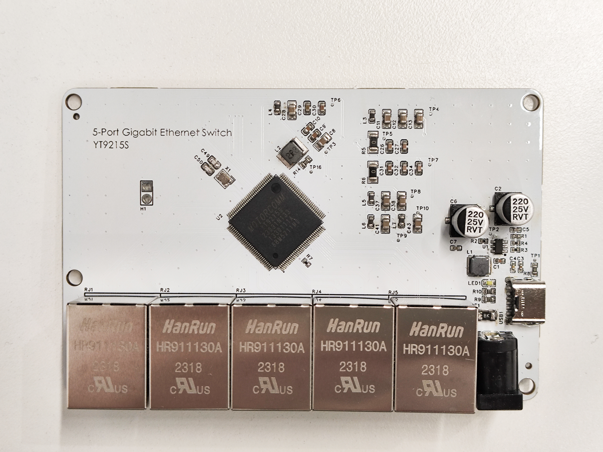
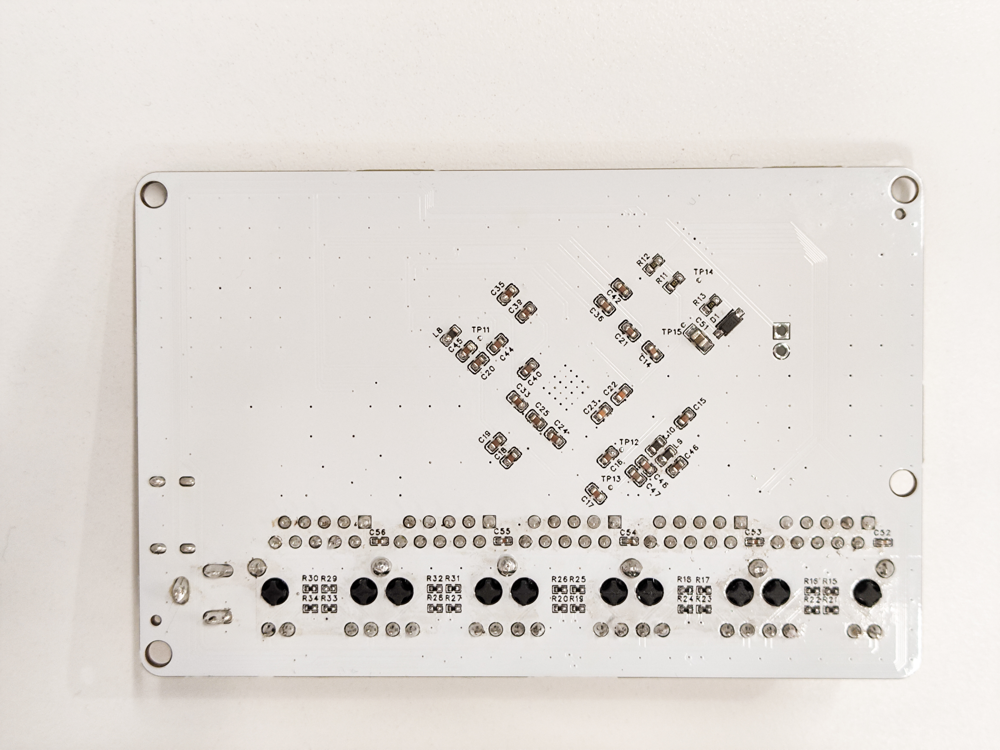
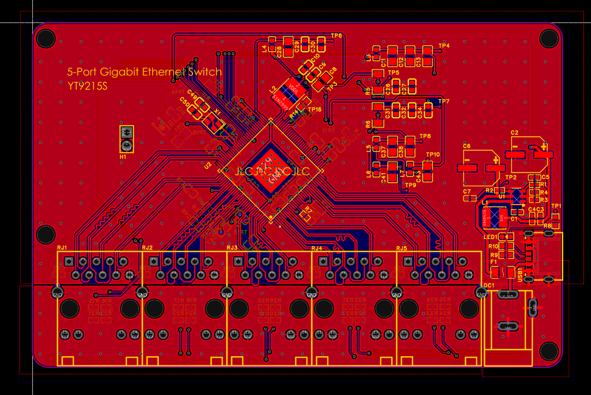
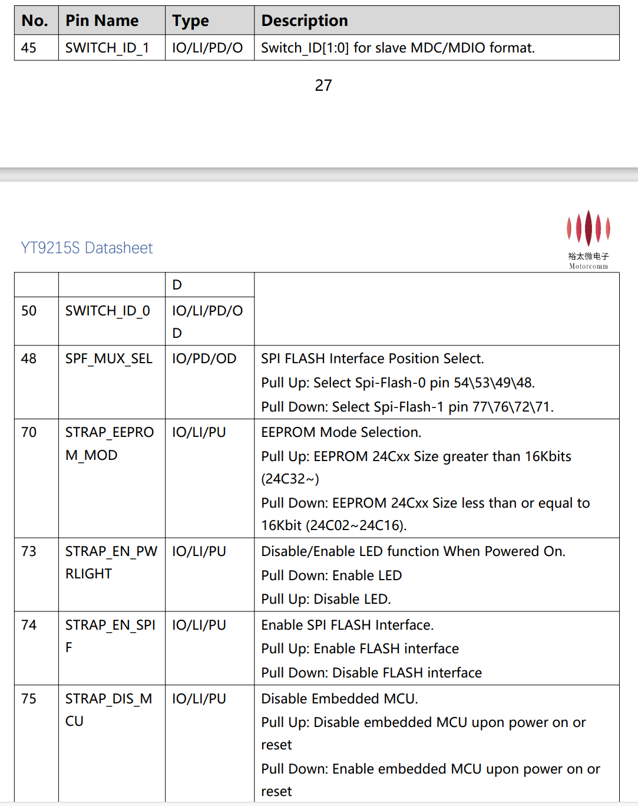
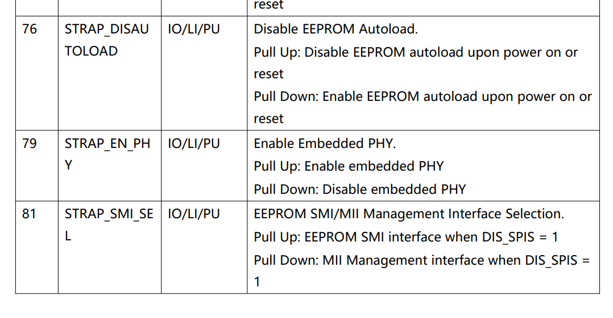
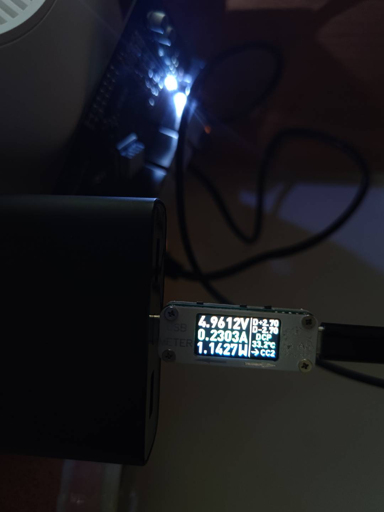
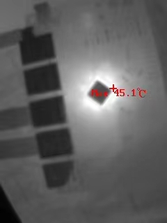
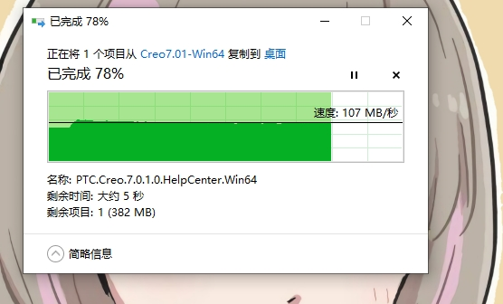
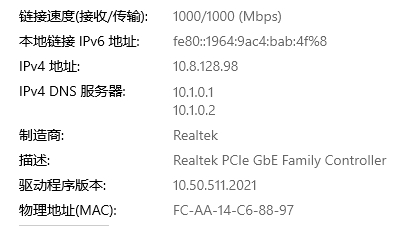
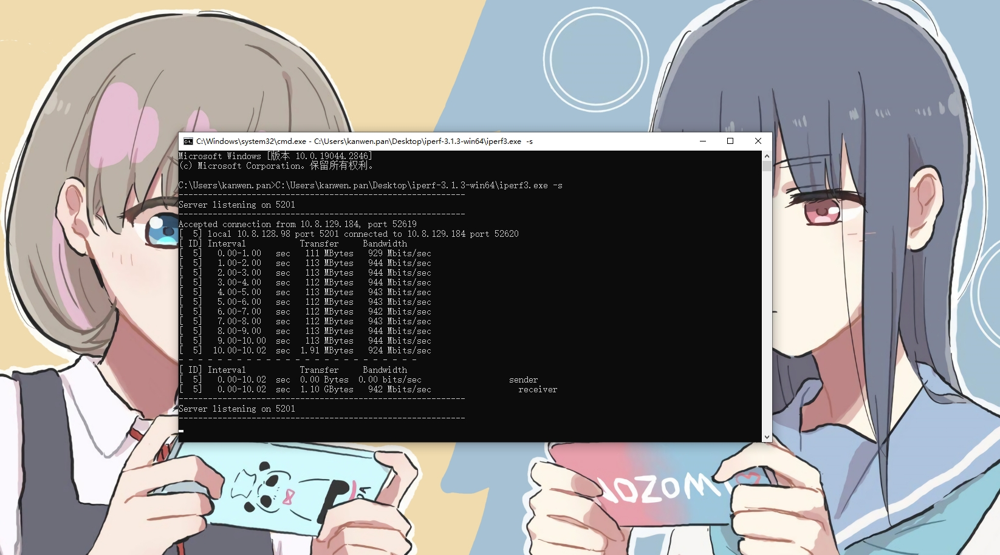

# 5-Port Gigabit Ethernet Switch based on the Motorcomm YT9215S

> English translation of the project description by [pankanwen](https://oshwhub.com/pankanwen),
> originally published at <https://oshwhub.com/pankanwen/wu-kou-qian-zhao-jiao-huan-ji-_yt9215s_v2_0>
> under CC BY-NC-SA 3.0. The original Chinese text is in [description.zh-CN.md](description.zh-CN.md);
> where the two differ, the original is authoritative. Translation added by the mirror maintainer.

**Summary:** An unmanaged gigabit switch based on the YT9215S. The Ethernet switch chip is the
Motorcomm (裕太微电子) YT9215S, with five copper RJ45 ports, powered over USB Type-C.

[Sep 12 update] Fixed incorrect values for some resistors in the Ethernet port section.

[Oct 26 update] Added photos of the built board.

**0. The schematic and software of this project are for learning and exchange only and must
not be used for any commercial purpose. Please respect the open source license!**

1. I am a beginner, so any advice is welcome.

2. Project description

This is an unmanaged gigabit switch based on the YT9215S. The Ethernet switch chip is the
Motorcomm YT9215S (in theory pin-to-pin compatible with the Realtek RTL8367S, but in testing
an RTL8367S would not boot in this board. Strange; I could not find the cause in the
datasheet). It has five copper ports, is powered over USB Type-C, and also has a provision
for a 12 V DC input.

3. Tested and working with no problems.

4. Configuration (strap) resistors

The multiplexed pins are sampled at power-on.

5. Test results

The pictures above show power consumption and temperature with two ports in use (with a
heatsink attached). With three ports in use, power is about 1.6 W.

(A heatsink is recommended: at 1.6 W without one, the chip reaches over 75 °C.)

6. Cost

The Ethernet switch chip is about ¥15 on Taobao; generic RJ45 jacks are a little over ¥2 each on Taobao.
