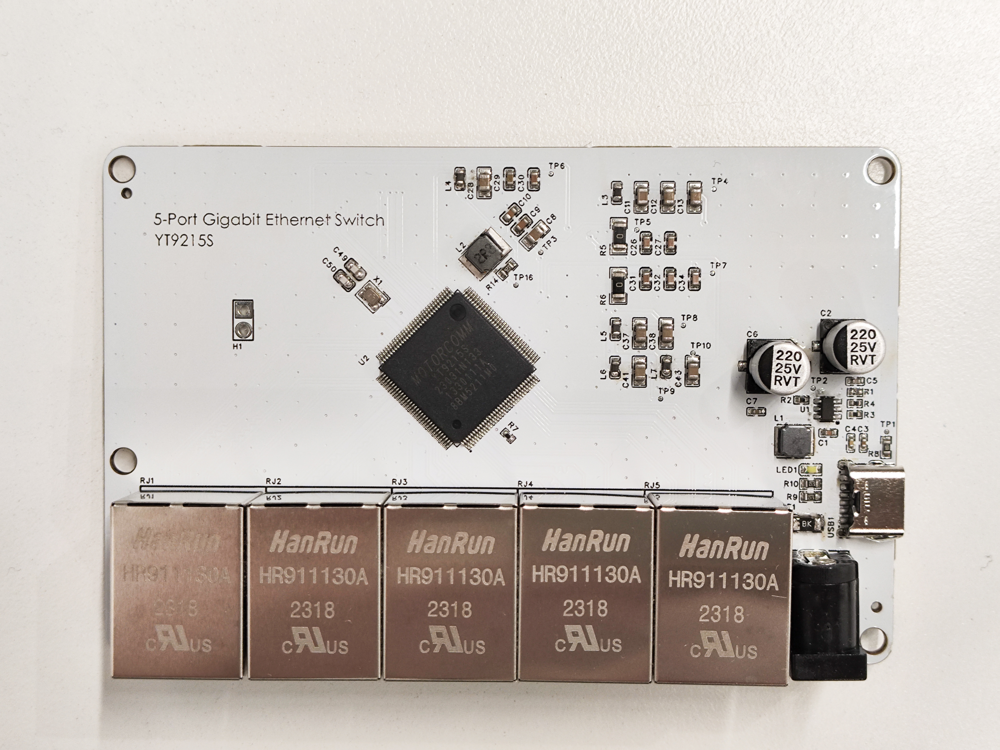
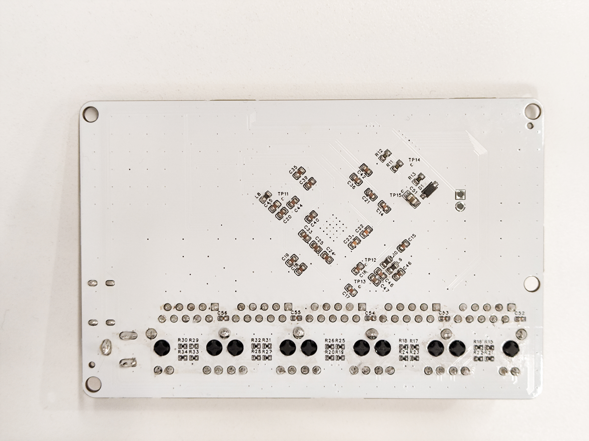
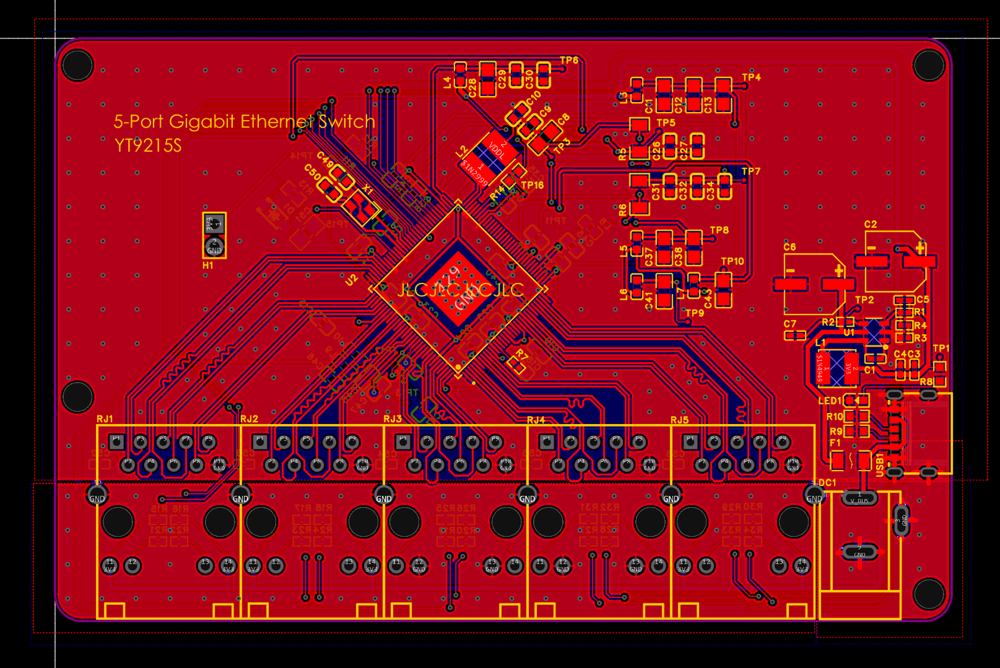
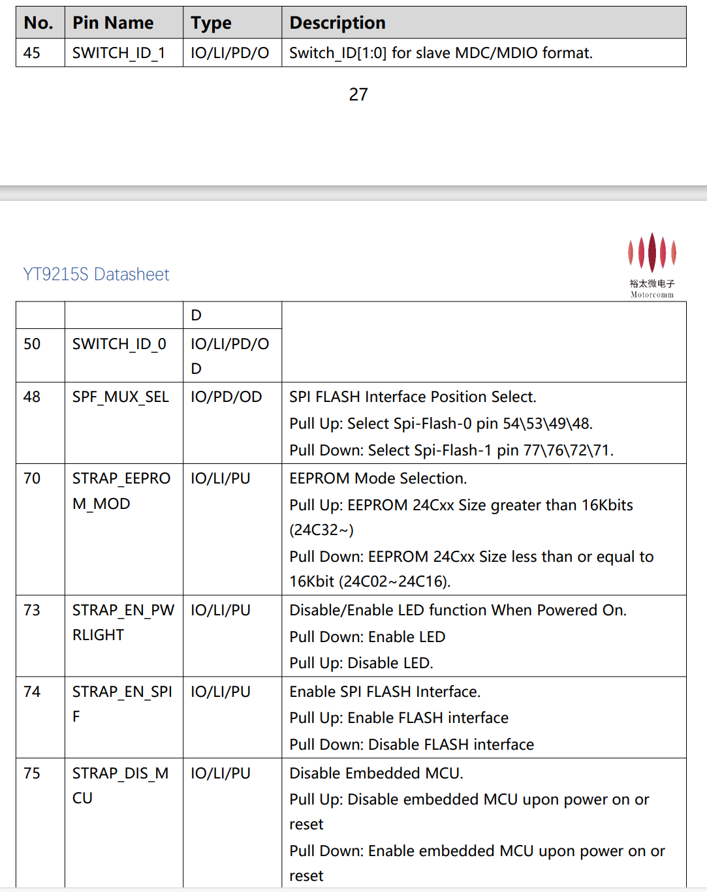
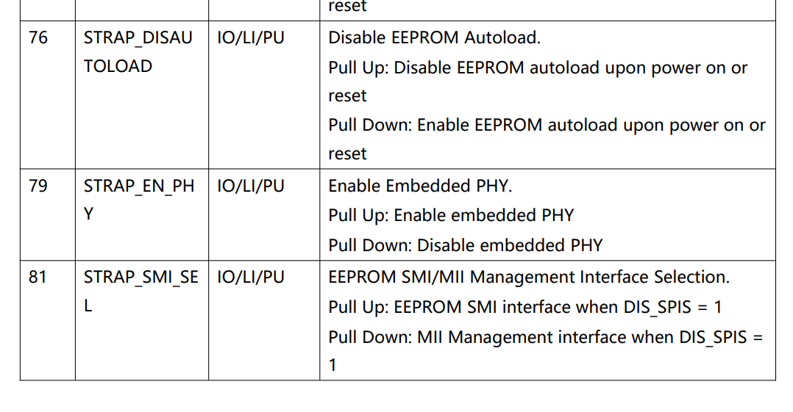
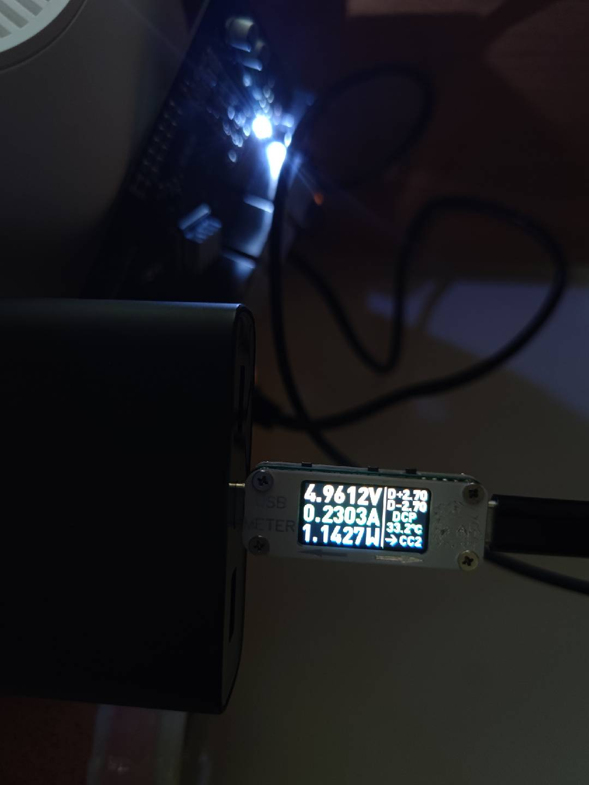
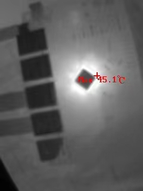
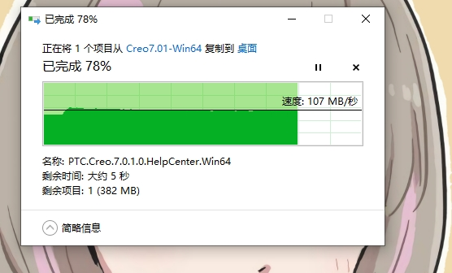
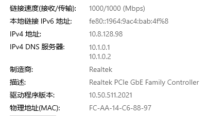
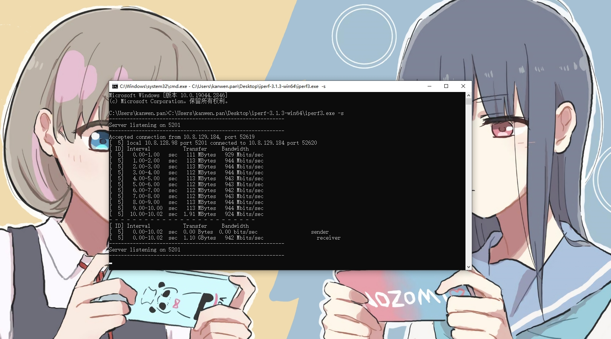

# 基于裕太微YT9215S的五口千兆交换机

> 原文镜像自 <https://oshwhub.com/pankanwen/wu-kou-qian-zhao-jiao-huan-ji-_yt9215s_v2_0>
> 作者：[pankanwen](https://oshwhub.com/pankanwen) · 开源协议：CC BY-NC-SA 3.0
> 以下内容为作者原文，仅将图片链接改为本仓库内的本地副本。

**简介：** 一款基于YT9215S的千兆傻瓜交换机，以太网交换芯片采用裕太微电子的YT9215S，接口为5电口，支持TYPE-C供电

[9.12更新]修正网口部分电阻阻值错误

[10.26更新]更新实物照片

**0.本工程原理图及软件仅供学习交流使用，不得用于任何商业用途，请遵守相关开源协议！**

1.本人为初学者，请各位不吝赐教

2.工程描述

这是一款基于YT9215S的千兆傻瓜交换机，以太网交换芯片采用裕太微电子的YT9215S（理论上Pin2Pin兼容瑞昱RTL8367S，实测boot不了？很奇怪 看了数据手册没找出问题），接口为5电口，支持TYPE-C供电并预留了DC 12V输入

3.已实测无问题

4.配置电阻

复用引脚在上电时读取电平

5.实测

上图为两个口功耗及温度（贴了散热），三个口功耗1.6W左右

（最好贴个散热，1.6W功耗不贴散热的话芯片有75度+）

6.价格

以太网芯片淘宝15块，网口淘宝寨版2块多一个
