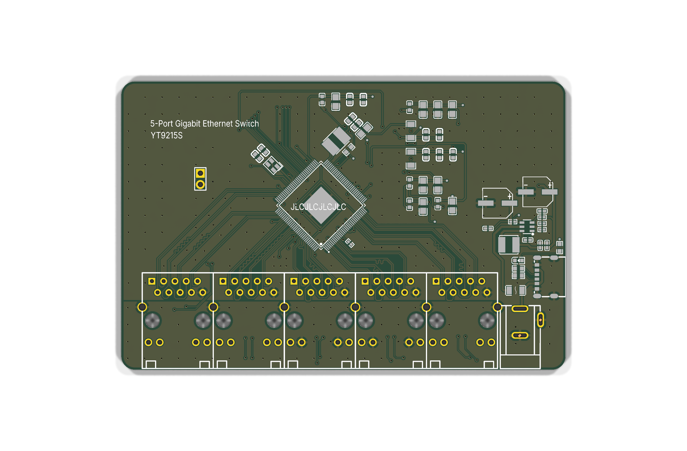

# KiCad version of the YT9215S 5-port switch

A KiCad 9 conversion of pankanwen's design, made with **KiCad's own EasyEDA Pro
importer** from [`../easyeda/YT9215S-5-port-switch.epro`](../easyeda/YT9215S-5-port-switch.epro), not redrawn by
hand. Same author, credit and licence (CC BY-NC-SA 3.0) as the rest of this repository;
see the [top-level README](../README.md).

Open [`YT9215S-5-port-switch.kicad_pro`](YT9215S-5-port-switch.kicad_pro) in KiCad 9.0 or newer.

## Files

| Path | Contents |
| --- | --- |
| [`YT9215S-5-port-switch.kicad_pro`](YT9215S-5-port-switch.kicad_pro) | Project (open this) |
| [`YT9215S-5-port-switch.kicad_sch`](YT9215S-5-port-switch.kicad_sch), [`1_P1.kicad_sch`](1_P1.kicad_sch), [`2_P2.kicad_sch`](2_P2.kicad_sch) | Schematic: root sheet, P1 (switch chip, power, crystal, LED, reset), P2 (five RJ45 ports) |
| [`YT9215S-5-port-switch.kicad_pcb`](YT9215S-5-port-switch.kicad_pcb) | PCB, 2 layers, 100 × 65 mm, zones filled |
| [`YT9215S-5--easyedapro.kicad_sym`](YT9215S-5--easyedapro.kicad_sym), [`YT9215S-5-port-switch.pretty/`](YT9215S-5-port-switch.pretty/) | Project symbol and footprint libraries written by the importer |
| [`render/`](render/) | Schematic [`schematic.pdf`](render/schematic.pdf), [`P1`](render/schematic-P1.png) and [`P2`](render/schematic-P2.png) PNGs; PCB [`pcb-layers.pdf`](render/pcb-layers.pdf) (one page per layer), [`top`](render/pcb-top-copper.png) and [`bottom`](render/pcb-bottom-copper.png) copper, [`top`](render/pcb-3d-top.png) and [`bottom`](render/pcb-3d-bottom.png) 3D |
| [`reports/`](reports/) | [`erc.rpt`](reports/erc.rpt), [`drc.rpt`](reports/drc.rpt) (with schematic parity), [`drc-exclusions.rpt`](reports/drc-exclusions.rpt), [`net-compare.txt`](reports/net-compare.txt) |
| [`tools/`](tools/) | Fix scripts [`fixup_import.py`](tools/fixup_import.py), [`fix_schematic_erc.py`](tools/fix_schematic_erc.py), [`fix_pcb_drc.py`](tools/fix_pcb_drc.py) (with helper [`sch_geometry.py`](tools/sch_geometry.py)), and [`compare_nets.py`](tools/compare_nets.py) (connectivity check) |

## How it was made

1. KiCad 9.0.9 (Ubuntu PPA), *Import Non-KiCad Project → EasyEDA (JLCEDA) Pro Project*
   on the [`.epro`](../easyeda/YT9215S-5-port-switch.epro) for the PCB, and *Schematic Editor → File → Import → Non-KiCad
   Schematic* on the same `.epro` for the schematic. The [`.epro2`](../easyeda/YT9215S-5-port-switch.epro2) file is a newer
   format that KiCad 9 can't read. The untouched importer output is the first commit
   that added this directory.
2. [`tools/fixup_import.py`](tools/fixup_import.py) (run with KiCad's Python) fixes the importer problems below.
   It is the second commit, so the diff shows exactly what changed.
3. [`tools/fix_schematic_erc.py`](tools/fix_schematic_erc.py) then [`tools/fix_pcb_drc.py`](tools/fix_pcb_drc.py) clear the remaining ERC,
   DRC and schematic-parity reports (third commit). Both scripts list each change with
   its reason at the top of each step.

### Rule checks

| Check | Raw import | After step 2 | Now |
| --- | --- | --- | --- |
| ERC | 613 | 353 | 0 |
| DRC | 1448 | 140 | 0 (4 excluded) |
| Unconnected | – | 1 | 0 |
| Schematic parity | – | 165 | 0 |
| Nets same in schematic and PCB | – | 77 of 157 | 117 of 117 |

The last row comes from [`compare_nets.py`](tools/compare_nets.py) ([`report`](reports/net-compare.txt)) and counts every net, including single-pin ones. An earlier version of this
README said the schematic and PCB matched; the check then skipped single-pin nets and
missed that the 40 Ethernet MDI nets were split in the schematic (see below).

The four DRC exclusions (in the [`project file`](YT9215S-5-port-switch.kicad_pro), each with a comment, listed in
[`reports/drc-exclusions.rpt`](reports/drc-exclusions.rpt)) are the shield holes that neighbouring RJ45 jacks share.
The five jacks are ganged at a 16 mm pitch and each jack's shield pin sits on its
edge, so RJ1's right shield and RJ2's left shield are one hole. EasyEDA's own drill file
drills these four holes twice as well. Changing that would mean redesigning the jack
footprint, so it is recorded as reviewed rather than changed.

### Importer problems found and fixed (step 2)

| Problem in the raw import | Effect | Fix |
| --- | --- | --- |
| SMD pads imported as through-hole[^smd] | Unmanufacturable; 61 shorts | Pads made SMD again |
| Wire net names became *local* labels | 10 LED nets cut between sheets | Global labels |
| Symbols point at a missing footprint library | 249 ERC warnings | Footprints set from the PCB |
| Case-only duplicate footprints | Breaks macOS/Windows checkouts | Duplicates removed |
| PCB footprint values empty | No values on the board | Copied from the schematic |
| EasyEDA design rules not imported | ~500 false clearance errors | 4 mil clearance, 10 mil track, 24/12 mil via |
| Copper zones not filled | | Zones refilled |

[^smd]: The [`.epro`](../easyeda/YT9215S-5-port-switch.epro) stores every SMD pad with a 0.001 mm placeholder hole, and the
importer turned all 367 SMD pads into all-layer through-hole pads. Pads with a hole
under 0.01 mm become SMD pads on their footprint's side: 250 top, 117 bottom and 89 PTH
pads, which is what EasyEDA's board statistics report ([`../pcb/pcb-info.txt`](../pcb/pcb-info.txt)).

### Schematic fixes (step 3, [`fix_schematic_erc.py`](tools/fix_schematic_erc.py))

* **Ethernet nets joined.** EasyEDA net labels are global across sheets. The importer
  made them local, so the 40 MDI nets between the switch chip (sheet P1) and the RJ45
  jacks (sheet P2) were cut in two. Labels used on more than one sheet are now global.
  This was a real connectivity error in the step 2 version, not just a warning.
* **Pin types.** EasyEDA gives every pin the default type "IN". These carry no design
  intent and became passive.
* **Power symbols.** The importer gave every power port one shared symbol whose pin was
  named after the first net it saw. Each power net now has its own power symbol, and a
  PWR_FLAG marks each power net that has no driving pin (13 nets).
* **Label wiring.** EasyEDA lets a net label sit part-way along a wire or just past its
  end. 21 labels moved to the wire end, and 2 dangling stubs were removed.
* **Unused pins.** No-connect flags on the 6 U2 pins that are unconnected on the PCB
  too (I²C, unused GPIO).
* Test points get the value "TestPoint". The two drawing-frame symbols are excluded
  from the board and BOM. MT2492 and the frame symbol, which existed in two versions
  under one name, get one library symbol per version.

### PCB fixes (step 3, [`fix_pcb_drc.py`](tools/fix_pcb_drc.py))

Fixed in the board:

* **USB-C shell.** The four shell tabs are GND in EasyEDA, but the importer kept the net
  on only two, so GND tracks into the other two were reported as shorts.
* **Keepouts.** EasyEDA "no copper pour" regions became full keepouts, which flagged the
  routed buck-converter and crystal tracks. They now keep out pour only.
* **Holes.** The four 3.2 mm mounting holes were imported as drawings on Edge.Cuts,
  so the board had none. They are NPTH holes again (MH1–MH4), and so are the RJ45
  plastic pegs. Two doubled vias were removed.
* **Crystal ground (design flaw).** X1's GND pads 2 and 4 are joined to each other but
  to nothing else. No pour reaches them in the EasyEDA design either, so the crystal's
  ground pads float. A GND via next to pad 2 now ties them to the bottom ground pour.
* **Names and values.** Nets renamed and values updated as *Update PCB from
  Schematic* would (33 nets, 16 values). Unused U2 pins get KiCad's
  `unconnected-(…)` nets. U2's exposed pad, a free pad in EasyEDA, is footprint EP1.
* **Placement.** RJ3 sat 0.034 mm off the jack pitch, so its shield holes were
  0.034 mm off the neighbours'. It is moved onto the pitch. Test pad TP10 moved 0.3 mm
  off C43's outline. The JLC order-number text moved off U2's exposed pad to the top
  left.
* **Rules.** Board-edge clearance is EasyEDA's 11.8 mil (0.3 mm), not KiCad's 0.5 mm
  default. One GND track sits 0.36 mm from the edge.
* The title text uses KiCad's font (Century Gothic isn't available). Three pads with a
  single thermal spoke into the GND pour are connected solidly.

Fixed in the footprint library:

* **RJ45 jack.** The library copy now has the NPTH pegs. Its outline sat on the edge
  line it shares with the next jack and ran over the shield pads. It is moved in by
  0.15 mm and broken around the pads. The courtyard follows the jack body, so ganged
  jacks no longer overlap.
* **USB-C and DC jack.** Outline clipped at the board edge (the USB-C receptacle
  overhangs it) and around RJ5's shield pad.
* **Test points** have no courtyard. They are bare pads with no part body.
* **6.3 mm electrolytic** (C2, C6) courtyard uses IPC-7351's 0.1 mm margin. The pads
  are 0.21 mm apart, as designed.
* **Library sync.** EasyEDA keeps a separate copy of each placed footprint, and rotation
  left sub-micron differences from the library copy (52 footprints). They are given the
  library graphics, as *Update Footprints from Library* would do. Pad positions are
  checked to match first.

### Not converted

* **3D models.** The [`.epro`](../easyeda/YT9215S-5-port-switch.epro) has no component 3D models, so KiCad's 3D view shows bare
  pads. The board's STEP model is in [`../pcb/pcb-3d.step`](../pcb/pcb-3d.step).
* The U2 symbol is still the RTL8367S-CG symbol from the original design; fit a YT9215S
  (see the [top-level README](../README.md)).
