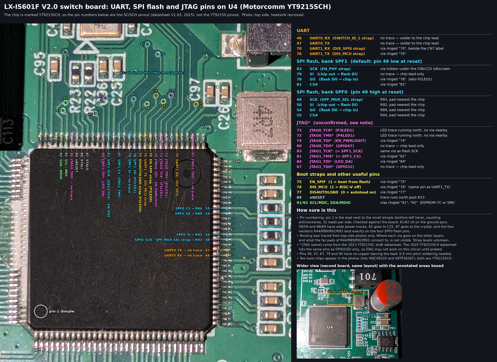

# LX-IS601F V2.0 switch board: debug pins

Photos of a bought switch board (silkscreen `LX-IS601F V2.0`) and an annotated image
showing where the UART, SPI flash and JTAG pins of its switch IC come out.

This is **not** the board mirrored in the rest of this repository. That design uses a
YT9215S; this board carries a **YT9215SCH**, which has a different pinout (see
[`../motorcomm-debug-pins.md`](../motorcomm-debug-pins.md)).

| File | What it is |
| --- | --- |
| `lx-is601f-debug-pins-annotated.png` | The annotated image, with a pin table and notes on confidence. |
| `photo-u4-macro.jpg` | Source photo: close-up of U4 with the heatsink removed. |
| `photo-u4-wide.jpg` | Source photo: wider view of a second board with the same layout. |
| `annotate.py` | Script that draws the annotations (`python3 annotate.py`, needs Pillow). |

## How the pins were found

* Pin numbers are from the YT9215SCH datasheet V1.03 (2025-02-10). JTAG names are from
  the YT9215SC Draft_07 datasheet (2023); the 2025 datasheet no longer lists them, so
  JTAG is unconfirmed.
* Pin 1 is the lead beside the small dimple on the package. Leads were counted from
  there, 32 per side, and checked against the ground pour (61/62), the wide power traces
  (58/59, 68/69), the decoupling capacitor on pin 82 and the crystal.
* Routing was traced from top-side photos only. Where the vias go on other layers, the
  strap levels, and what the far pads of R44/R89/R92/R93 connect to are not known.
